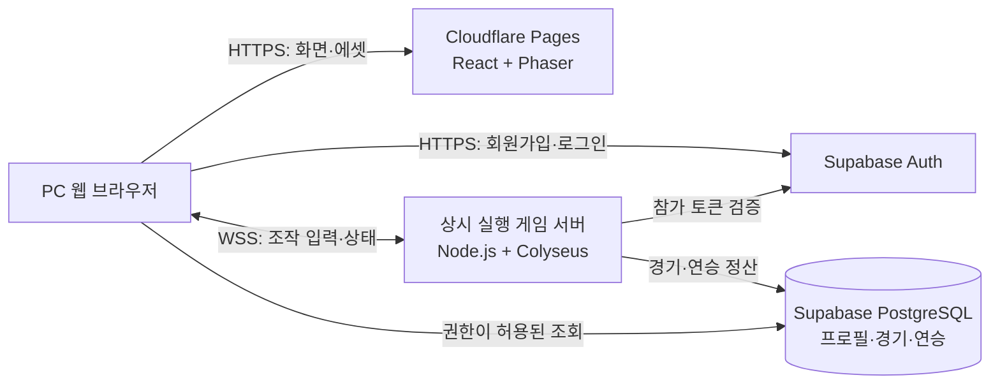

# PRD — 웹 기반 2D 1:1 연승 데스매치

- 문서 버전: 0.4 — 다운 추가 공격·기상·궁극기 게이지 검수 초안
- 작성 및 인터넷 자료 확인일: 2026-11-06, 한국 시간
- 가칭: Deathmatch Online
- 대상: PC 웹 브라우저, 키보드 사용자
- 목적: 사용자의 요구사항, 추천 개발 도구, 재사용할 디자인 에셋, 개발 범위와 사용자 준비 사항을 하나의 구현 기준으로 정리한다.

> 개발 진행 안내: 이 문서는 최초 제품 기획입니다. 이후 생성한 로컬 개발 기반의 실행 방법과 실제 구현 상태는 [README.md](../README.md), 다음 작업은 [개발 목록](ROADMAP.md)을 확인하세요. 이 문서의 MVP 전체가 구현된 상태는 아닙니다.

> 2026-11-06 변경: 사용자가 시작 캐릭터를 주먹·검·화살·마법 4종으로 지정했다. 기존 단일 캐릭터 가정을 변경하며, 캐릭터별 8개 스킬과 선택·연승 정책은 [캐릭터 기획안](CHARACTERS.md)의 검수 초안이다. 이번 문서는 사용자 요청에 따라 UI 목업의 참고 기획으로 `feature/lobby-ui`에 함께 공유하며 세부 규칙은 후속 검수로 조정한다.

> **추천 조합: Phaser 4 + React + Vite + TypeScript / Node.js + Colyseus / Supabase Auth + PostgreSQL.**
>
> 1:1 대전은 독립된 실시간 게임 서버에서 판정하고, 로그인·회원·전적은 Supabase로 관리한다. 캐릭터와 맵은 무료 CC0 에셋으로 시작한다. 아래에서 ‘확정 요구사항’ 이외의 시점·스킬 내용·수치·운영 규칙은 구현을 위한 제안이며, 사용자 확정 사항으로 간주하지 않는다.

## 1. 제품 개요와 핵심 경험

짧은 1:1 전투에서 상대 체력을 0으로 만들고, 승리하면 다음 상대와 계속 싸워 자신의 최고 연승 기록을 갱신하는 게임이다. 사용자는 경기 사이에 자유롭게 쉬었다가 같은 계정으로 돌아와 이어 할 수 있다.

핵심 재미는 방향키 이동, 공통 방어·대시·기본/다운 추가 공격과 선택한 캐릭터의 고유 기술, 상대 공격 회피에서 만든다. 시작 캐릭터는 주먹·검·활·마법 4종이며 키 역할은 공통으로 고정하고 기술 내용을 캐릭터별로 구성한다. 첫 밸런스 초안은 기본 체력·이동 속도·몸 크기를 같게 두고 기술로 차이를 만든다. 연승·레벨·유료 장비에 따른 전투 능력 보너스는 주지 않는다.

### 1.1 확정 요구사항

| 항목 | 사용자 요구사항 |
| --- | --- |
| 장르 | 2D 1:1 데스매치 |
| 플랫폼 | 웹 기반 |
| 이동 | 키보드 상하좌우 방향키 |
| 전투 키 | A 웅크려 막기, S 대시, D 기본 공격, F 쓰러진 상대 추가 공격, Q/W/E 기본 스킬 1/2/3, R 궁극기 |
| 궁극기 | 공격 성공·받은 피해로 게이지 충전, 100%에서 활성화 |
| 시작 캐릭터 | 주먹·검·화살·마법 4종, 정식 이름 미정 |
| 계정 | 로그인 및 회원가입 |
| 반복 플레이 | 승리하면 계속 플레이 가능 |
| 중지 | 플레이 도중 중지 가능 |
| 핵심 기록 | 연속 승리 |

### 1.2 구현을 위한 기본 제안

| 미정 항목 | 제안 기본값 | 이유 |
| --- | --- | --- |
| 화면 시점 | 위에서 내려다보는 탑다운 아레나 | 상하좌우 이동 및 2D 타일 에셋 활용에 적합 |
| 대전 방식 | 서로 다른 PC에서 접속하는 온라인 PvP | 웹 기반 1:1 대전 경험을 기준으로 설계 |
| 조준 | 마지막 이동 방향, 대각선 포함 8방향 | 전투에 마우스가 필요 없도록 구성 |
| 최초 캐릭터의 기술 구성 | A/S 공통 역할, D/F·Q/W/E·R의 캐릭터별 기술 | 4종 × 8개 입력 항목에 공통 동작을 포함하는 검수안 |
| 경기 길이 | 제한 시간 120초, 단판 | 연승을 반복하기 쉬운 길이 |
| 휴식 | 경기 사이에는 현재 연승 보존 | 잠깐 쉬는 것을 패배로 처리하지 않음 |
| 경기 중 중지 | 메뉴 열기는 가능, 기권 시 패배 | 한쪽만 전체 경기를 멈추면 상대가 기다려야 함 |
| 동점 | 무승부, 양쪽 현재 연승 종료 | 승리만 연속되는 기록으로 정의 |
| 최초 서비스 범위 | 한국 사용자 중심, 단일 서버 지역 | 초기 매칭 인구와 운영 범위 집중 |

**‘중지’의 해석은 특히 확인이 필요한 제품 결정이다.** 이 문서는 경기 사이 휴식과 경기 중 기권을 제공하는 안이다. 진행 중인 경기를 저장했다가 나중에 재개하거나, 두 사람이 동의해 일시정지하는 기능이 필요하면 별도 규칙과 개발 범위를 추가한다.

## 2. 목표와 MVP 범위

### 2.1 MVP 완료 목표

1. 서로 다른 PC의 사용자가 회원가입 후 로그인하여 실제 온라인 경기를 한다.
2. 시작 캐릭터 4종을 선택하고 방향키와 고정된 8개 키 역할로 방어·대시·공격·기술·게이지 궁극기를 사용할 수 있다.
3. 서버가 충돌·체력·스킬 재사용 대기시간·승패를 판정한다.
4. 승리 후 다음 경기로 이어 가거나 연승을 보존하고 쉬는 것이 가능하다.
5. 패배 시 현재 연승은 종료되고 최고 연승은 남는다.
6. 새로고침·재로그인 후에도 확정된 전적과 연승이 유지된다.

### 2.2 출시 범위

| 우선순위 | 포함 기능 |
| --- | --- |
| P0: MVP 필수 | 이메일 회원가입·로그인·로그아웃·이메일 인증·비밀번호 재설정 |
| P0 | 닉네임, 현재 연승, 최고 연승, 승패 수 |
| P0 | 주먹·검·활·마법 캐릭터 4종, 대칭 아레나 1개, 방향키·공통 키 역할·고유 기술·궁극기 게이지 |
| P0 | 공개 1:1 매칭, 준비 상태, 3초 카운트다운 |
| P0 | 승패·무승부·기권·접속 끊김 처리 |
| P0 | 결과 화면, 다음 상대 매칭, 매칭 취소, 경기 사이 휴식 |
| P0 | 재접속, 서버 결과 저장, 중복 정산 방지 |
| P0 | 최고 연승 순위표, 기본 음량 설정, 키 안내 |
| P1: 후속 | Google 등 소셜 로그인, 키 재지정, 연습용 봇 |
| P1 | 초대 코드 친선전 — 공개 연승 기록과 분리 |
| P1 | 실력 기반 매칭, 신고·운영 도구 강화, 5번째 이후 추가 캐릭터·맵 |
| P2: 확장 | 관전, 리플레이, 시즌, 장식 아이템, 다중 서버 지역 |

MVP 제외: 모바일 터치 조작, 로컬 2인 대전, 성장형 장비, 결제, 채팅, 길드, 진행 중 경기의 장기 저장·재개. 캐릭터별 스킬 세트는 4종 계획에 포함하는 검수안으로 변경했다.

## 3. 프레임워크 조사와 선정

### 3.1 최종 추천 스택

| 영역 | 추천 | 담당 역할 | 선정 이유 |
| --- | --- | --- | --- |
| 게임 클라이언트 | **Phaser 4** | 렌더링, 입력, 애니메이션, 맵, 소리 | 2D 웹 게임에 맞는 기능과 공식 예제·템플릿 제공 |
| 웹 화면 | **React** | 로그인, 로비, 결과, 순위표, 설정 | 게임 바깥 화면을 웹 UI로 관리 |
| 개발 환경 | **Vite + TypeScript** | 개발 서버, 빌드, 타입 검사 | Phaser 공식 React·TypeScript 템플릿 활용 가능 |
| 게임 서버 | **Node.js + Colyseus** | 대전 방, 실시간 상태 동기화, 접속 관리 | 서버가 게임 상태를 결정하는 구조와 Phaser 연동 자료 제공 |
| 인증·영속 저장 | **Supabase Auth + PostgreSQL** | 계정, 인증, 프로필, 경기 결과, 연승 | 인증과 데이터베이스를 직접 처음부터 만들 필요를 줄임 |
| 맵 편집 | **Tiled** | 타일 맵과 충돌 영역 편집 | 시각적으로 맵을 만들고 공통 맵 데이터로 활용 |
| 간단한 그림 수정 | **Piskel** | 픽셀 이미지·애니메이션 수정 | 브라우저에서 스프라이트를 편집하고 PNG로 내보내기 |
| 웹 배포 | **Cloudflare Pages** | React·Phaser 빌드와 정적 에셋 배포 | 웹 클라이언트 배포 담당 |
| 게임 서버 배포 | **Render 유료 Web Service, 최초 싱가포르 후보** | 상시 실행 Node.js 프로세스와 WebSocket | 배포 단순성 우선. 한국 회선 지연 측정 후 확정 |

Phaser는 웹용 2D 프레임워크이며 JavaScript·TypeScript를 지원한다. React·Vite 공식 템플릿도 제공한다. 조사일 기준 공식 Phaser 4 릴리스 목록의 최상단 버전은 **4.2.1**이다. 신규 개발은 4.x를 기준으로 하되 실제 착수 때 호환 버전을 고정한다. [Phaser 소개](https://www.phaser.io/oss/docs/phaser/getting-started/what-is-phaser), [공식 템플릿 목록](https://www.phaser.io/oss/docs/phaser/getting-started/project-templates), [Phaser 4 릴리스](https://phaser.io/download/phaser4).

Colyseus에는 대전 방과 상태 동기화 기능이 있고, 공식 Phaser 튜토리얼이 방향키 이동·보간·클라이언트 예측·고정 주기 처리를 다룬다. 이 조합은 요구사항과 직접 맞닿은 출발점을 제공한다. 단, 이 게임의 전투·연승·공정한 상대 선택 규칙은 별도 구현해야 한다. [Colyseus 문서](https://docs.colyseus.io/), [Phaser 멀티플레이 튜토리얼](https://docs.colyseus.io/learn/tutorial/phaser).

Supabase Auth는 회원 인증을 맡긴다. 실시간 이동·공격 데이터는 Colyseus가 처리하고, Supabase에는 계정과 영구 기록을 저장한다. [Supabase Auth](https://supabase.com/docs/guides/auth).

‘사람들이 많이 쓰는 것’은 정확한 시장점유율 순위로 단정하지 않았다. 공식 템플릿, 예제, 문서, 공개 저장소와 기존 사용 사례가 있어 구현 자료를 재사용하기 쉬운 생태계를 우선했다.

### 3.2 다른 선택지와 비교

| 후보 | 적합한 상황 | 이번 기획에서의 판단 |
| --- | --- | --- |
| Phaser | 브라우저 중심 2D 게임, 웹 화면과 함께 개발 | **채택** |
| Godot | 시각적 엔진 편집기로 게임을 만들거나 PC 버전까지 확장 | 유효한 대안. 브라우저 내보내기 요구사항과 웹 인증 연동을 추가 검토해야 함 |
| PixiJS | 렌더링을 중심으로 게임 구조를 직접 설계 | 훌륭한 렌더러지만 이번에는 Phaser의 게임 기능을 활용하는 편이 효율적이라는 판단 |
| Colyseus | 방 단위 게임 상태·접속 관리가 필요한 실시간 멀티플레이 | **채택** |
| Socket.IO | 범용 실시간 이벤트 통신을 직접 설계 | 가능하지만 대전 방·게임 상태·동기화 정책을 더 직접 작성해야 하므로 차선 |

비교 근거: Godot 웹 출력은 WebAssembly·WebGL 2.0 등의 조건을 확인해야 한다. PixiJS는 2D 렌더러, Socket.IO는 양방향 이벤트 통신 라이브러리로 소개된다. 선정 결론은 이 프로젝트의 요구사항에 따른 판단이다. [Godot 웹 내보내기](https://docs.godotengine.org/en/stable/tutorials/export/exporting_for_web.html), [PixiJS](https://pixijs.com/), [Socket.IO 소개](https://socket.io/docs/v4/).

### 3.3 바로 재사용할 출발점과 버전 방침

- 클라이언트: [Phaser 공식 React + TypeScript 템플릿](https://github.com/phaserjs/template-react-ts).
- 서버: [Colyseus Getting Started](https://docs.colyseus.io/getting-started)에서 기본 서버 생성.
- 이동·네트워크 참고: [Colyseus 공식 Phaser 튜토리얼](https://docs.colyseus.io/learn/tutorial/phaser).
- 맵: [Tiled](https://www.mapeditor.org/), 스프라이트 수정: [Piskel](https://www.piskelapp.com/).

조사한 React 템플릿은 저장소 설명에 Phaser 3 문구가 남아 있지만, `package.json`의 Phaser 의존성은 4.0.0이었다. 템플릿 이름만 믿지 말고 실제 의존성을 확인한다. 4.2.1 적용 시 먼저 이동·맵·애니메이션·빌드를 검증한다. [확인한 package.json](https://github.com/phaserjs/template-react-ts/blob/main/package.json).

Colyseus도 공식 문서에서 조사 시점 0.18 계열이 보이므로 해당 문서와 호환되는 서버·SDK 조합을 사용한다. 오래된 튜토리얼의 API를 그대로 섞지 않는다. Node.js는 착수 당시 지원 중인 LTS 중 선택한 라이브러리가 지원하는 버전을 사용하고, lockfile에 버전을 고정한다. 이 PRD 작성 단계에서는 패키지를 설치하거나 호환성 실행 검증을 하지는 않았다.

## 4. 캐릭터·맵·UI 에셋 계획

### 4.1 추천 시각 방향

16px 타일을 정수 배율로 확대하는 픽셀 아트 아레나를 기본안으로 한다. 한 화면에 경기장 전체를 보여 주고 카메라는 고정한다. 플레이어는 푸른색·주황색 테두리와 머리 위 표식으로 구분한다. 색상 외에도 내 캐릭터 표식과 상대 표식을 달리한다.

한 화풍 안에서 주먹·검·활·마법을 구분하는 실루엣과 동작을 준비한다. 기존 에셋을 재사용하되 4종의 무기·모션·방향 프레임과 라이선스를 실제 파일로 확인한다. 시각 크기가 서버의 공통 충돌 크기를 바꾸지 않게 한다. 외형·인물 설정은 [캐릭터 기획안](CHARACTERS.md)을 검수해 정한다.

### 4.2 다운로드 후보

| 용도 | 후보와 링크 | 확인한 이용 조건 | 적용 제안 |
| --- | --- | --- | --- |
| 캐릭터·던전 타일 | [Kenney Tiny Dungeon](https://kenney.nl/assets/tiny-dungeon) | 무료 다운로드, CC0, 16×16 타일 | **최초 프로토타입 기본안** |
| 캐릭터·던전 타일 대안 | [0x72 DungeonTileset II](https://0x72.itch.io/dungeontileset-ii) | 제작자 페이지에 CC0, 자율 가격 | 애니메이션과 분위기를 검토해 Kenney 대신 선택 가능 |
| 키보드 안내 | [Kenney Input Prompts](https://kenney.nl/assets/input-prompts) | CC0, 키보드·마우스 기호 포함 | 방향키와 스킬 키 가이드 |
| UI 소리 | [Kenney Interface Sounds](https://kenney.nl/assets/interface-sounds) | CC0 | 버튼·로비 알림음. 전투 효과음은 별도 확보 또는 제작 |
| 스킬 아이콘 | [Game-icons.net](https://game-icons.net/about.html) | CC BY 3.0, 원저작자 표시 필요 | 캐릭터별 8개, 총 32개 슬롯용 아이콘 목록 검토. 선택한 아이콘별 저작자 기록 |

Kenney는 에셋 페이지의 게임 에셋에 대해 상업적 사용 가능, 저작자 표시 의무 없음이라고 안내한다. 개별 무료 다운로드와 유료 All-in-1 묶음은 구분한다. [Kenney 이용 안내](https://kenney.nl/support).

**이 팩들이 캐릭터 4종의 기술·무기·방향별 애니메이션을 모두 제공한다고 보장하지 않는다.** 다운로드 후 프레임 구성을 확인해야 한다. CC0 후보 중 하나를 주 스타일로 선택하고, 서로 다른 화풍의 캐릭터와 타일을 무조건 섞지 않는다. 위 링크는 조사 후보이며 파일 다운로드·구매·프로젝트 반입은 아직 하지 않았다.

### 4.3 추가 제작이 필요한 부분

| 항목 | MVP 제작 방식 |
| --- | --- |
| 캐릭터 외형 | 4종의 실루엣·무기·모션을 준비하고 플레이어별 표식·테두리 적용 |
| 대기·이동 | 제공 프레임을 우선 사용. 방향 프레임이 부족하면 간단한 이동 흔들림과 조준 화살표로 방향 표시 |
| 공격 | 캐릭터 모션 부족분을 무기·궤적·범위 표시 이펙트로 보완 |
| 피격·사망 | 점멸, 짧은 밀림, 사망 페이드. 서버 판정과 시각 효과를 분리 |
| 캐릭터별 8개 스킬 효과 | 총 32개 슬롯의 투사체·근접 타격·방어·범위·상태 표현 제작, 공통 효과 재사용 |
| 경기장 | 기존 타일로 대칭 맵 제작, 충돌 영역과 시작 지점 지정 |
| UI | 체력, 쿨다운, 현재·최고 연승, 승패 배너, 결과 화면 제작 |
| 브랜딩 | 게임명, 로고, 대표 이미지 결정 및 제작 |

캐릭터 그림이 비대칭이면 좌우 반전 시 무기 위치가 달라질 수 있다. 전투 방향과 명중 영역은 그림에 의존하지 않고 서버 데이터로 정의한다. Tiled 맵에서 `visual`, `collision`, `spawn` 정보를 구분하며, 서버도 같은 충돌·시작 위치 데이터를 읽는다.

에셋을 채택할 때는 원본 주소·제작자·라이선스·다운로드일·수정 내역을 `docs/ASSET_LICENSES.md`에 기록한다. CC BY 아이콘은 게임 크레딧에서 제작자·출처·라이선스·수정 여부를 표시한다. 다른 사람이 올린 확장팩은 원본 팩과 라이선스가 같다고 가정하지 않는다.

## 5. 플레이 흐름과 화면

```text
접속 → 회원가입/로그인 → 로비 → 대전 찾기
                                  ↓
                     상대 배정 → 에셋 로딩·준비 → 3초 카운트다운
                                  ↓
                              1:1 전투
                                  ↓
                        서버 결과 확정·기록 저장
                         ↙                    ↘
                      승리                   패배/무승부
                 현재 연승 +1               현재 연승 0
                    ↓                           ↓
          다음 상대 찾기 / 쉬기            새 도전 / 로비
```

| 화면 | 필수 정보·동작 |
| --- | --- |
| 시작 | 게임 소개, 조작 안내, 로그인·회원가입 진입 |
| 계정 | 회원가입, 이메일 인증 안내, 로그인, 비밀번호 재설정 |
| 로비 | 닉네임, 캐릭터 4종 선택·스킬 설명, 현재·최고 연승, 승패 수, 대전 찾기, 순위표, 설정 |
| 매칭 | 대기 시간, 취소 버튼, 연결 상태, 상대를 찾는 중이라는 안내 |
| 전투 | 두 캐릭터 표시·체력 바, 제한 시간, 현재 연승, 선택 캐릭터의 8개 스킬·쿨다운, 네트워크 상태 |
| 전투 메뉴 | 소리 설정, 돌아가기, 기권. 메뉴가 경기를 멈추지 않는다는 표시 |
| 결과 | 승패 사유, 이번 경기로 바뀐 연승, 최고 기록, 다음 경기·쉬기 |
| 순위표 | 최고 연승 상위 100명, 내 최고 기록·순위 |

승리 후 결과 화면에서 ‘계속하기’를 누르면 다음 상대를 찾는다. 편의를 위한 ‘승리 후 자동 매칭’ 옵션은 기본 해제로 두고, 켜면 결과 확정 후 5초 뒤 자동 대기열에 들어간다. 자동 진행은 언제든 취소할 수 있다. 결과 화면에서 아무 입력이 없으면 새 경기는 시작하지 않는다.

## 6. 조작과 전투 규칙

### 6.1 입력

| 입력 | 동작 |
| --- | --- |
| ↑ ↓ ← → | 이동 |
| 대각선 두 방향 동시 입력 | 대각선 이동, 속도는 직선 이동과 동일하게 정규화 |
| A | 누르고 있는 동안 웅크려 막기, 놓으면 해제 |
| S | 대시 1회 요청 |
| D | 기본 공격 1회 요청 |
| F | 쓰러진 상대 추가 공격 1회 요청, 다운 대상·현재 회차·거리·방향 확인 |
| Q W E | 기본 스킬 1/2/3 각각 1회 요청 |
| R | 궁극기 게이지 100%일 때 사용 요청 |
| Esc | 메뉴 열기·닫기. 온라인 전투는 계속 진행 |

- 화면의 스킬 바는 실제 키 배치처럼 윗줄 `Q W E R`, 아랫줄 `A S D F`로 표시한다.
- 멈춰 있을 때는 마지막 유효 이동 방향을 바라본다. 최초 방향은 양쪽 시작 위치에서 상대 쪽이다.
- 방향키와 스킬을 동시에 누르면 해당 입력 시점의 방향으로 스킬을 사용한다.
- 반대 방향 동시 입력은 해당 축을 0으로 처리한다. 방향이 0이면 이전 조준 방향을 유지한다.
- A는 유지·해제 상태로 전송한다. 다른 전투 키는 누른 순간 1회 요청하며 브라우저 반복 입력으로 연속 발동하지 않는다.
- 방어 가능한 상태의 A 유지가 다른 행동과 겹치면 A를 우선한다. A 외의 동시 행동은 수신 순서, 같은 묶음은 `S→D→F→Q→W→E→R` 중 첫 사용 가능한 행동을 처리한다.
- 게임 영역에 포커스가 있을 때 방향키 스크롤을 막고, 텍스트 입력창에서는 게임 입력을 받지 않는다.
- 창 포커스를 잃으면 눌린 키를 해제한다. 서버는 입력 갱신이 250ms 이상 없으면 이동을 정지시킨다.
- 일부 키보드는 다중 키 입력을 누락할 수 있으므로 실제 키보드로 이동+스킬 조합을 확인한다. 키 재지정은 P1으로 둔다.

### 6.2 전투 기본값

- 체력 100, 별도 마나·스태미나 없음. A는 유지 입력, S/D/F/Q/W/E는 일반 쿨다운, R은 궁극기 게이지와 시전 상태로 사용을 제한한다.
- 기본 이동 속도 180 게임 좌표 px/s, 경기장 기준 크기 960×640. 화면 크기에 따라 표시만 확대·축소한다.
- 별도 마우스 기본 공격은 없다. D는 캐릭터별 기본 공격, F는 쓰러진 상대 추가 공격, Q/W/E는 기본 스킬 1/2/3, R은 궁극기다. A는 웅크려 막기이며 공격 슬롯이 아니다.
- 공격은 서버에서 명중·피해를 계산한다. 벽은 이동과 직선 투사체를 막는다.
- 돌진은 벽을 통과하지 않는다. 기본안에서는 플레이어끼리 몸 충돌로 길을 막지 않는다.
- 경기 시작 시 체력·일반 쿨다운·버프·디버프·방어 유지 상태와 궁극기 게이지를 초기화한다. 게이지는 새 경기마다 0%이며 같은 경기 재접속에는 기존 값을 복원한다.
- 카운트다운 중 이동·스킬은 잠그고 시작 시 입력 상태와 투사체를 초기화한다.
- 체력 0이면 즉시 경기 종료. 같은 서버 틱에 양쪽 체력이 0이 되면 무승부다.
- 120초 경과 시 남은 체력 비율이 높은 쪽 승리, 같으면 무승부다.

### 6.3 기존 프로토타입의 단일 임시 스킬 구성

아래 표는 현재 코드의 임시 기술을 설명하는 기록이며 4종 전체에 공통 적용하는 스킬표가 아니다. 승인 후 캐릭터별 기술로 대체할 예정이다. 새 4종의 32개 입력 항목과 변경 조작·궁극기 게이지는 [캐릭터 기획안](CHARACTERS.md)과 [조작·게이지 명세](COMBAT_CONTROLS.md)를 검수한다. 아래의 옛 A 공격·D 대시·R 20초 쿨다운은 현재 코드 설명이며 새 설계에는 적용하지 않는다. 모든 재사용 대기시간은 서버 시간을 기준으로 한다.

| 키 | 가칭 | 효과 초안 | 쿨다운 | 대응·구현 포인트 |
| --- | --- | --- | --- | --- |
| A | 베기 | 전방 70px, 90도 부채꼴, 피해 12 | 0.7초 | 0.12초 준비 후 판정, 한 번에 상대 1회 피격 |
| S | 마력탄 | 조준 방향으로 520px/s 투사체, 피해 16, 최대 사거리 480px | 3초 | 벽이나 상대에 닿으면 소멸 |
| D | 돌진 | 조준 방향으로 최대 120px, 0.18초 이동 | 5초 | 피해·무적 없음, 벽 앞에서 멈춤 |
| F | 보호막 | 1.2초 동안 피해 합계 20까지 흡수 | 8초 | 중첩 불가, 체력 회복 없음 |
| Q | 폭발 | 자기 주변 반경 90px, 0.5초 예고 후 피해 22 | 7초 | 예고 원을 보고 범위에서 벗어날 수 있음 |
| W | 속박탄 | 직선 투사체, 피해 8, 1.5초간 이동 속도 40% 감소 | 9초 | 벽에 막힘. 둔화 중첩 없이 남은 시간만 갱신 |
| E | 충격파 | 전방 120px·폭 60px, 피해 10, 최대 60px 밀어냄 | 6초 | 0.2초 준비, 밀려나도 벽 통과 불가 |
| R | 결정타 | 전방 300px·폭 64px, 0.8초 예고 후 피해 35 | 20초 | 예고 중 시전자 이동 불가, 판정이 벽 너머로 가지 않음 |

기존 프로토타입은 발동 사이 최소 0.25초, 시전 중 다른 기술 사용 불가, 시전 시작부터 쿨다운을 적용한다. 새 4종에서는 이 기본 흐름을 유지하되 무효·투사체 제거·피해 감소·보호막과 다단 공격의 차이를 캐릭터 기획안의 규칙으로 검수한다. 같은 틱의 피해를 모아 반영하는 동시 사망 원칙은 유지한다.

4종 각각의 8개 키와 캐릭터 조합·시작 위치를 바꿔 테스트한다. 명중률·경기 길이·기술 의존도·회피 가능성을 기록해 수치를 조정한다. 기존 단일 스킬 구성의 검증만으로 4종 밸런스가 완료됐다고 판단하지 않는다.

### 6.4 다운·추가 공격 상태 — 세부 검수안

다운은 HP가 남아 있는 쓰러짐이며 HP 0의 KO·경기 종료와 구분한다. 초기안은 다운 1.0초 → 기상 0.3초 → 일반 상태 복귀 후 다운 면역 1.5초다. 각 캐릭터의 지정 기술이 유효한 HP 피해를 주고 정면 A 가드가 성립하지 않을 때 다운을 유발한다. 지면 공격은 해당 가드 조건을 적용하지 않는다.

F는 같은 다운 회차에 한 번 유효 적중하고 HP가 남으면 기상으로 전환한다. 다른 공격의 다운 연장·연속 눕히기를 막고, 기상과 동시에 명중하면 서버의 시간 만료 판정을 먼저 적용한다. 구체적인 대상 상태·공격 취소·피해·복원·예외는 [공통 명세](COMBAT_CONTROLS.md)를 따른다. 지정 다운 기술과 지속 시간은 사용자 검수 후 확정한다.

### 6.5 새 공통 조작·궁극기 게이지 명세

A는 유지형 웅크려 막기, S 대시, D 기본 공격, F 쓰러진 상대 추가 공격, Q/W/E 기본 스킬 1/2/3, R 궁극기로 고정한다. F는 사용자 확인에 따라 HP가 남아 있는 다운 상대에게 추가 공격하는 기술로 확정한다. 다운 유발·지속·기상·추가 공격 제한 수치는 검수안이다. A의 정면 피해 50% 감소와 유지 중 이동·행동 불가도 세부 초안이다.

궁극기는 공격 성공·받은 피해로 충전해 100%에서 활성화한다. 일반 실제 HP 피해 1당 공격자 2%·피격자 1%를 초기 계수안으로 두고, 방어·보호막·오버킬 이후 실제 HP 피해만 계산한다. 자신의 궁극기 피해는 자기 게이지를 충전하지 않지만 피격자는 실제 받은 피해로 충전한다.

서버가 유효한 R을 승인할 때 전부 소비하고 시전을 시작한다. 기존 R 고정 시간 쿨다운을 대신하며 새 경기에는 0%, 같은 경기 재접속에는 기존 값을 유지한다. 입력·정수 게이지·피해 사건·중복 방지·HUD·수용 기준은 [상세 명세](COMBAT_CONTROLS.md)를 따른다. 계수와 방어 수치는 검수·플레이 테스트 후 조정한다.

## 7. 연승·승패·중지·재접속

### 7.1 기록 정의

- `current_streak`: 휴식 구간을 제외하고 연속으로 승리한 횟수.
- `best_streak`: 계정이 달성한 최고 연승. 현재 연승이 끝나도 보존한다.
- `wins`, `losses`, `draws`: 공개 대전에서 확정된 승리·패배·무승부 수.
- 순위표: `best_streak` 내림차순 → 해당 최고 기록을 처음 달성한 시간 오름차순 → 사용자 ID 순으로 정렬한다.
- 현재 연승은 로비와 전투 HUD에 강조하고, 순위표의 기준은 최고 연승으로 한다.
- MVP에는 시즌 초기화나 휴식 만료 기간을 두지 않는다.

### 7.2 결과별 처리

| 상황 | 현재 연승 | 최고 연승 | 상대 처리 |
| --- | --- | --- | --- |
| 정상 승리 | +1 | 필요 시 갱신 | 패배자의 현재 연승 0 |
| 정상 패배 | 0 | 보존 | 승리자는 +1 |
| 무승부 | 양쪽 모두 0 | 보존 | 양쪽 `draws` +1 |
| 결과 화면에서 쉬기·로그아웃 | 보존 | 보존 | 새 상대와 매칭하지 않음 |
| 상대 배정 전 매칭 취소 | 보존 | 보존 | 경기 결과 없음 |
| 경기 준비·카운트다운 단계 이탈 | 보존 | 보존 | 경기 취소, 반복 시 매칭 제한 |
| 전투 시작 후 명시적 기권 | 0, 패배 +1 | 보존 | 상대 승리 +1 |
| 전투 중 접속 종료 후 10초 내 복귀 | 경기 상태 유지 | 기존 값 유지 | 전투는 계속됨 |
| 한쪽만 접속 종료, 10초 내 미복귀 | 해당 사용자 패배, 0 | 보존 | 연결을 유지한 상대 승리 |
| 서버 장애로 결과 확정 불가 | 기존 기록 보존 | 보존 | 해당 경기 무효, 승패 미반영 |

예: 4연승 → 쉬기 → 다음 날 로그인 시 4연승 → 승리하면 5연승 → 패배하면 현재 0, 최고 5다. 4연승 뒤 무승부면 현재 0, 최고 4다. 무효 경기는 연승을 끊지 않는다.

### 7.3 접속·중복 참여의 세부 규칙

- 잠깐 끊겼다고 경기를 멈추지 않는다. 연결이 끊긴 캐릭터는 이동 입력만 0으로 바꾸며 공격받을 수 있다. 끊김 전에 승인된 시전·투사체는 계속 처리한다.
- 체력 0이나 제한 시간 판정이 재접속 유예 만료보다 먼저 오면 그 결과를 우선한다.
- 두 사용자 모두 끊긴 상태에서 종료 사유가 발생하면, 확정된 사망·시간 종료 결과가 없을 경우 무효 처리한다. 이탈 시각·세션 정보를 남겨 반복적인 악용을 조사할 수 있게 한다.
- 재접속 유예는 한 경기의 전체 연결 끊김 시간을 합쳐 최대 10초로 하여 반복 접속으로 시간을 연장하지 못하게 한다.
- 새로고침 시 로그인 상태와 재접속 토큰으로 기존 경기에 먼저 복귀를 시도한다. 복귀가 실패하면 이미 확정된 결과를 조회한다.
- 한 계정은 동시에 한 대기열 또는 한 경기에만 참여한다. 다른 탭에서는 기존 경기에 대한 읽기 안내를 보여 주고 새 매칭을 거절한다.
- 공식 재접속 기능을 활용하되 유예 시간, 결과 우선순위, 중복 참여 제한은 게임 서버에서 구현한다. [Colyseus 재접속 문서](https://docs.colyseus.io/room/reconnection).

## 8. 매칭 정책

MVP에서는 단일 지역 공개 대기열을 운영한다. 같은 계정끼리 매칭하지 않고 오래 기다린 사용자를 우선한다. 승자는 새 경기로 이동하되 연승만 이어받는다. 같은 방에 영원히 남아 있어야 하는 구조는 아니다.

| 항목 | 기본 정책 |
| --- | --- |
| 매칭 기준 | 같은 모드·서버 지역의 대기 사용자, 대기 시간 우선 |
| 연승 보너스 | 전투 능력 보너스 없음 |
| 상대 정보 | 배정 전에 상대 닉네임·연승을 공개하지 않음 |
| 준비 제한 | 양쪽 에셋 로딩 완료까지 최대 15초, 실패 시 경기 취소 |
| 준비 후 이탈 | 10분 내 3회면 60초 매칭 제한이라는 초기안 |
| 대기 30초 경과 | 대기 중임을 명확히 표시, 취소·나중에 다시 찾기 제공 |
| 인구 부족 | 봇을 실제 사용자처럼 투입하지 않음 |
| 반복 상대 | 다른 상대가 있으면 직전 상대를 피함. 30초 이후 대안이 없으면 재매칭 허용 |
| 친선전 | P1, 초대 상대와 연승 순위표 기록 분리 |

Colyseus의 방 생성·참가 기능 위에 이 정책을 작성한다. 프레임워크가 승수 조작이나 실력 매칭을 자동으로 해결한다고 가정하지 않는다. 동일 계정 쌍의 반복 경기, 지나치게 빠른 기권, 비정상 승률은 운영 로그로 남긴다. 공개 매칭 인구가 적으면 지인끼리 승수를 주고받는 문제를 완전히 막기 어렵다는 한계가 있다.

## 9. 계정·프로필

### 9.1 필수 동작

- 이메일·비밀번호 회원가입, 이메일 인증, 로그인·로그아웃, 비밀번호 재설정.
- 이메일 인증 전에는 로비를 볼 수 있지만 공개 대전 참여는 제한한다.
- 닉네임은 2~12자, 한글·영문·숫자·밑줄 허용, 앞뒤 공백 제거, 대소문자 무시 중복 검사.
- 닉네임은 서버에서 검증하고, 이메일 주소는 다른 사용자에게 공개하지 않는다.
- 로그인 만료 시 다음 매칭 전에 세션을 갱신한다. 경기 중 이미 인증된 세션의 종료 판정은 유지하고, 다음 경기 참가 때 다시 유효성을 확인한다.
- 회원 탈퇴 진입점과 운영자 연락 경로를 제공한다. 계정·기록 삭제 또는 익명화 방식과 안내 문구는 공개 전 운영자가 결정한다.

### 9.2 인증 연동 원칙

게임 서버는 참가 요청의 Supabase access token을 검증해 사용자 ID를 얻는다. 브라우저가 제출한 사용자 ID나 연승 값을 신뢰하지 않는다. 서명·만료·발급자·대상 값 검증은 공식 클라이언트의 `getClaims()` 또는 검증 라이브러리로 처리한다. 키 형식에 맞는 공식 검증 방식을 사용한다. [Supabase JWT 문서](https://supabase.com/docs/guides/auth/jwts).

공개 회원가입을 운영하려면 자체 SMTP 발송 서비스 설정을 준비한다. Supabase 기본 이메일 발송은 테스트 제한이 있으므로 임의의 신규 회원에게 인증·비밀번호 재설정 메일이 정상 도착하는지 출시 전에 검증한다. [Supabase SMTP 안내](https://supabase.com/docs/guides/auth/auth-smtp).

## 10. 시스템 구조



### 10.1 클라이언트와 서버 책임

| 클라이언트 | 게임 서버 |
| --- | --- |
| 키 입력 수집, 화면·소리·애니메이션 | 이동·충돌·스킬 발동 가능 여부 |
| 내 이동을 먼저 보여 주는 예측 | 좌표·투사체·명중·피해의 실제 계산 |
| 상대 이동 보간, 서버 좌표로 보정 | 경기 시간·결과·기권·접속 종료 판정 |
| 쿨다운과 체력을 서버 상태에 맞춰 표시 | 경기·전적·연승의 영속 저장 |

클라이언트가 전송할 값은 이동 방향, 누른 스킬, 입력 순번 등으로 제한한다. ‘상대에게 35 피해’, ‘내가 승리’, ‘현재 좌표는 원하는 위치’ 같은 결과를 직접 제출하는 구조를 만들지 않는다. 서버 권한 구조도 버그나 모든 치팅을 자동으로 없애지는 않으므로 입력 검증과 기록 보호가 필요하다.

### 10.2 동기화 기본안

- 게임 시뮬레이션: 고정 30틱/초, 상태 전송: 20회/초를 초기값으로 한다.
- 입력은 변경 시 전송하고, 이동 중 최대 30회/초 갱신한다. 과도한 메시지는 제한한다.
- 로컬 이동은 예측하고 서버의 마지막 처리 입력 순번을 기준으로 보정한다. 상대는 짧은 버퍼로 보간한다.
- 공유 전투 모듈은 브라우저 전용 API 없이 실행되도록 작성한다. 클라이언트 예측과 서버의 이동 계산이 같은 규칙을 사용한다.
- 서버 판정용 충돌은 단순 원·사각형·선분으로 구현한다. Phaser의 화면용 물리와 서버의 별도 물리가 같은 결과라고 가정하지 않는다.
- 빠른 투사체는 이전 위치부터 새 위치까지 선분 충돌을 검사해 한 틱에 상대를 뚫고 지나가는 문제를 막는다.
- WebSocket 전송 상태와 RTT를 표시한다. MVP는 과거로 되감아 명중을 다시 계산하는 지연 보상을 제외하므로 고지연 환경의 불리함을 실측한다.
- DB에는 매 프레임 좌표를 기록하지 않는다. 경기 시작·최종 결과·전적 및 필요한 이벤트를 저장한다.

위 틱·전송·지연 수치는 라이브러리 기본값에 대한 설명이 아니라 이 프로젝트의 초기 설계값이다.

### 10.3 프로젝트 구조 제안

```text
apps/
  web/                 # React 화면, Phaser 씬, 입력·표현
  game-server/         # Colyseus 방, 인증, 매칭, 정산
packages/
  shared/              # 입력 형식, 게임 규칙, 스킬 수치, 순수 전투 계산
assets/
  source/              # 채택한 원본과 라이선스
  maps/                # Tiled 원본과 충돌·시작 위치 데이터
supabase/
  migrations/          # 테이블, 정책, 정산 함수
docs/
  PRD.md
  ASSET_LICENSES.md
```

이는 앞으로 생성할 구조이며 현재 구현된 파일 목록이 아니다. React 상태에 매 프레임 좌표를 넣지 않고 Phaser가 전투 화면을 관리하도록 한다.

## 11. 데이터와 결과 정산

### 11.1 핵심 데이터

| 테이블 | 주요 필드·역할 |
| --- | --- |
| `auth.users` | Supabase가 관리하는 인증 계정 |
| `profiles` | `user_id`, `nickname`, `nickname_normalized`, `created_at` |
| `player_stats` | `user_id`, `current_streak`, `best_streak`, `best_streak_achieved_at`, `wins`, `losses`, `draws` |
| `matches` | `id`, 두 참가자 ID, `status`, `winner_id`, `reason`, `started_at`, `ended_at`, `rules_version`, `server_instance_id` |
| `match_participants` | `match_id`, `user_id`, `outcome`, `streak_before`, `streak_after`, 최종 체력 |
| `active_participations` | `user_id` 유일, `queue_or_match_id`, `state`, `lease_expires_at`; 중복 참가 방지 |
| `match_events` | 필요한 범위의 기권·접속 단절·운영 조사 이벤트. 보관 기간 제한 |

`matches.status`는 `preparing`, `active`, `finalizing`, `completed`, `cancelled`, `void` 등으로 구분한다. `reason`은 `ko`, `timeout`, `surrender`, `disconnect`, `draw`, `server_failure` 등을 기록한다. 시각은 UTC로 저장하고 화면에서는 한국 시간으로 표시한다.

### 11.2 정산 요구사항

1. 경기 시작 전에 경기 ID와 참가자, 경기 규칙 버전을 영구 저장한다.
2. 종료 조건이 발생하면 더 이상 입력을 처리하지 않고 정산 단계로 전환한다.
3. 경기 ID를 기준으로 결과, 두 참가자의 승패 수, 현재·최고 연승을 **하나의 DB 트랜잭션**에서 반영한다.
4. 동일 경기의 정산 요청이 반복돼도 한 번만 반영한다. 기존 결과와 다른 요청은 덮어쓰지 않고 오류로 기록한다.
5. 참가자 통계 행 잠금과 경기 상태 조건으로 동시 정산·다중 탭의 기록 충돌을 방지한다.
6. DB 저장 전에는 ‘결과 저장 중’으로 표시하고 다음 매칭을 시작하지 않는다. 저장 후 확정 결과를 전달한다.
7. DB 오류면 같은 경기 ID로 재시도한다. 서버가 살아 있는 동안 최종 결과를 유지하며, 클라이언트에는 확정되지 않은 승수를 표시하지 않는다.
8. 프로세스 장애로 최종 결과가 영구 저장되지 않았다면 다음 복구 작업에서 유효 기간이 지난 진행 경기를 무효 처리하고 참가 잠금을 해제한다. 이미 완료된 정산은 취소하지 않는다.

MVP는 진행 중인 전투의 메모리 상태를 새 서버로 복원하지 않는다. 결과 커밋 전에 서버 자체가 종료되면 해당 경기를 무효로 해야 하는 한계가 있다. 커밋 직후 클라이언트가 끊겨도 재조회로 같은 확정 결과를 보여 준다.

## 12. 기록 보호와 운영 기본 요건

- 공개 스키마 테이블에는 RLS를 적용한다. 일반 사용자는 허용된 프로필·순위 정보만 읽고 자신의 허용된 프로필 항목만 수정한다.
- 승패·연승·경기 결과·최고 기록 달성 시각은 브라우저에서 직접 변경할 수 없게 한다. 서버 전용 정산 경로만 쓰기 권한을 갖는다.
- 서버 전용 DB 자격 증명과 Supabase secret/service-role 키는 브라우저 번들·저장소에 포함하지 않는다. 웹에서 쓰는 publishable key는 별도 구분한다.
- 조회용 순위표에는 닉네임·최고 연승 등 공개 항목만 제공하고 이메일·인증 정보는 포함하지 않는다.
- 인증 토큰은 URL 쿼리나 로그에 남기지 않는다. HTTPS/WSS와 허용 출처 설정을 사용한다.
- 메시지 형식·크기·빈도, 스킬 쿨다운, 이동 속도, 입력 순번을 서버에서 검증한다. 예전 입력의 재전송으로 공격이 중복 발동하지 않도록 한다.
- 로그인·매칭 요청 제한, 반복 준비 취소 제한, 비정상 경기 기록 조회 수단을 마련한다.
- 비밀 키·비밀번호를 로그에 기록하지 않는다. 공개 전 개인정보 안내, 계정 삭제 안내, 문의 경로를 실제 운영 방식에 맞게 준비한다.

RLS는 사용자별 행 접근을 제한하는 PostgreSQL 기능이다. 서버의 높은 권한은 정책을 우회할 수 있으므로 서버 전용 자격 증명도 최소 범위로 관리한다. [Supabase RLS 문서](https://supabase.com/docs/guides/database/postgres/row-level-security).

## 13. 배포와 예상 비용

### 13.1 첫 배포 구성

- 웹 클라이언트는 Cloudflare Pages에 빌드 결과와 에셋을 올린다. React SPA 경로 새로고침과 인증 복귀 주소를 설정한다. [Cloudflare React 배포 안내](https://developers.cloudflare.com/pages/framework-guides/deploy-a-react-site/).
- 게임 서버는 WebSocket을 받는 상시 실행 Node.js 서비스로 배포한다. Render가 해당 연결을 지원한다. [Render WebSocket 문서](https://render.com/docs/websocket).
- Render의 조사일 기준 지역 중 싱가포르를 최초 후보로 한다. 한국 사용자의 실제 RTT가 목표를 넘으면 서울·도쿄 서버를 제공하는 호스팅으로 게임 서버를 이전하는 안을 비교한다. 싱가포르가 항상 빠르다고 가정하지 않는다. [Render 지역 목록](https://render.com/docs/regions).
- Supabase 프로젝트는 게임 서버와 데이터베이스 왕복 시간을 함께 고려해 지역을 선택한다. 전투 판정 경로에는 매 틱 DB 호출을 넣지 않는다.
- 운영 서버는 단일 프로세스에서 시작한다. 여러 프로세스로 늘릴 때 대기열·참가 잠금·방 라우팅과 공유 상태를 함께 설계한다.
- 배포·점검 전 새 매칭을 중지하고 진행 경기가 끝나도록 기다린다. 급작스러운 재시작은 무효 경기 처리를 거친다.

### 13.2 비용 계획

| 단계 | 구성 | 비용 판단 |
| --- | --- | --- |
| 로컬 검증 | 로컬 웹·게임 서버, 무료 에셋, Supabase Free | 호스팅 지출 없이 시작 가능. 개발 인건비·개인 장비 제외 |
| 비공개 테스트 | 정적 웹 호스팅, 작은 게임 서버, Supabase Free 또는 Pro | 사용량과 이메일 발송 조건에 따라 결정 |
| 소규모 공개 베타 | 항상 켜진 유료 게임 서버 + DB + SMTP | **월 US$40~100을 초기 예산 가정**으로 제안. 공급자 견적·수용 인원 보장 아님 |
| 이용자 증가 | 서버 증설·트래픽·DB·모니터링 | 동시 접속자와 실제 전송량을 측정해 다시 산정 |

조사일 공식 Supabase 가격은 Free US$0, Pro 월 US$25부터다. 추가 자원·초과 사용·세금은 별도일 수 있다. Render 유료 인스턴스의 실제 금액은 배포 시 요금표에서 확인한다. 위 US$40~100은 이를 포함해 잡은 프로젝트 예산 추정치이며, 달러·원 환율 변환은 적용하지 않았다. [Supabase 가격](https://supabase.com/pricing), [Render 가격](https://render.com/pricing).

Render 무료 Web Service는 15분간 수신 트래픽이 없으면 중지될 수 있고 재기동 시간이 발생한다. 무료 서비스는 기술 검증용으로만 고려하고, 공개 매칭 서버 예산은 별도 확보한다. Supabase Free도 비활성 프로젝트 중지 조건이 있다. [Render 무료 서비스 제한](https://render.com/docs/free), [Supabase 가격·무료 조건](https://supabase.com/pricing).

게임 서버 비용은 회원 수보다 동시 접속자, 초당 전송량, 틱 처리 시간에 크게 좌우된다. 예를 들어 사용자당 평균 서버 송신 2KB × 초당 20회 × 동시 접속 100명은 약 4MB/s, 1시간 약 14.4GB다. 이는 규모 감각을 위한 단순 계산이며 실제 직렬화 크기·헤더·압축·활동 시간을 측정해 바꿔야 한다. 단일 프로세스로 가능한 인원은 부하 테스트 전 확정하지 않는다.

## 14. 품질 목표와 출시 검증

아래 수치는 초기 목표이며 지원 기기에서 측정해 확정한다. 기본 성능 측정 환경은 내장 그래픽이 있는 일반 노트북, 1080p 화면, 최신 안정판 데스크톱 Chrome, 전투 캔버스 960×640 상당이다. Edge·Firefox·Safari도 필수 기능을 점검하고 실제 버전·장치 정보를 기록한다.

| 항목 | 목표·검증 방법 |
| --- | --- |
| 화면 성능 | 일반 전투에서 60fps 목표. 프레임 시간과 느린 구간 기록 |
| 네트워크 | 주요 테스트 회선에서 RTT p95 100ms 이하 목표. 초과 시 지역·동기화 재검토 |
| 서버 처리 | 30틱/초의 틱 처리 시간 p95 25ms 이하를 목표로 동시 경기 부하 측정 |
| 접속 복구 | 설정된 누적 10초 유예 내 재접속 시 기존 체력·쿨다운·시간 복원 |
| 결과 무결성 | 같은 경기 결과 10회 재요청에도 승수·연승 1회만 반영 |
| 예외 상황 | 네트워크 지연·지터·끊김, 새로고침, 종료 직전 기권, 서버 재시작, DB 오류 검증 |
| 첫 로딩 | 실제 에셋 다운로드 용량과 로딩 시간 측정, 로딩 상태 표시 |

### 14.1 MVP 수용 기준

- [ ] 서로 다른 PC에서 회원가입·이메일 인증·로그인 후 매칭할 수 있다.
- [ ] 비밀번호 재설정 이메일이 외부 테스트 계정에 도착하고 새 비밀번호로 로그인된다.
- [ ] 두 사용자에게 같은 경기 시작·종료 상태가 보인다.
- [ ] 네 방향·대각선 이동이 동작하고 대각선이 더 빠르지 않다.
- [ ] 4종 모두 A 방어·S 대시·D 기본·F 다운 추가 공격·Q/W/E 기본 스킬·R 궁극기로 연결된다.
- [ ] F는 살아 있는 다운 상대와 현재 다운 회차에만 명중하고 서 있는 상대·KO 상대는 거절한다.
- [ ] 다운·기상·면역·F 1회·동시 만료·재접속 상태를 서버와 화면에서 일치시킨다.
- [ ] A 누름·해제·포커스 상실·입력 만료를 구분하고 방어 중 다른 행동을 거절한다.
- [ ] 일반 HP 피해로 게이지가 충전되고, 100% 미만 R 거절·유효 R 한 번 소비·경기별 초기화를 검증한다.
- [ ] 캐릭터별 효과·쿨다운·예고 표시와 방어·다단 공격이 서버에서 일치한다.
- [ ] 경기 중 캐릭터 교체가 거절되고 재접속 시 같은 캐릭터로 복귀한다.
- [ ] 벽 충돌, 투사체 명중, 보호막, 둔화, 밀치기가 양쪽 화면과 서버에서 일치한다.
- [ ] 승리 3회 → 현재·최고 3, 휴식·재로그인 → 3 유지, 패배 → 현재 0·최고 3이 된다.
- [ ] 무승부는 현재 연승을 종료하고, 서버 장애 무효 경기는 기존 기록을 보존한다.
- [ ] 승리 후 다음 상대 찾기와 쉬기가 모두 가능하며, 자동 매칭 옵션을 취소할 수 있다.
- [ ] 진행 중 기권·재접속 유예 만료가 중복 승리를 만들지 않는다.
- [ ] 결과 저장 후 연결이 끊겨도 재로그인 시 동일한 결과를 조회한다.
- [ ] 한 계정의 여러 탭·세션으로 동시 대전에 참가할 수 없다.
- [ ] 일반 사용자의 API 요청으로 타인의 프로필·경기·연승을 수정할 수 없다.
- [ ] 100회 경기 정산 반복 테스트에서 중복 정산·기록 유실이 없다.
- [ ] 후보 서버에서 실제 한국 회선 지연과 단계별 동시 경기 부하를 측정했다.
- [ ] 채택 에셋의 라이선스와 필요한 저작자 표기를 게임 및 저장소에 반영했다.

자동 검증은 전투 계산·쿨다운·연승 전이·중복 정산·접근 권한에 집중한다. 실제 두 브라우저와 두 PC로 조작감·동기화·회원가입 흐름을 함께 확인한다.

## 15. 개발 순서와 예상 일정

아래 **8~12주 추정과 단계별 기간은 기존 단일 캐릭터 범위의 계획 기록**이다. 시작 캐릭터를 4종으로 늘렸으므로 검수 후 공통 전투 일반화·32개 슬롯·선택 UI·에셋·매치업 검증 작업을 다시 산정한다. 현재 표를 4종 완성 일정으로 약속하지 않는다.

| 단계 | 예상 기간 | 산출물·다음 단계 진입 조건 |
| --- | --- | --- |
| 0. 요구사항·기술 검증 | 0.5~1주 | 시점·중지·연승 규칙 선택, 템플릿 빌드, Phaser·Colyseus 두 브라우저 이동 확인 |
| 1. 전투 프로토타입 | 1~2주 | 임시 도형 또는 기존 에셋으로 방향키·8스킬·충돌·서버 승패 구현 |
| 2. 온라인 품질 | 1.5~2주 | 예측·보간, 카운트다운, 기권, 재접속, 지연 환경 테스트 |
| 3. 계정·기록 | 1~2주 | 가입·로그인·메일, DB 정책, 중복 정산 방지, 연승·최고 기록 |
| 4. 게임 흐름·디자인 | 1~2주 | 매칭·결과·휴식·순위표, 정식 채택 에셋·효과음·UI |
| 5. 배포·비공개 테스트 | 1.5~3주 | 실서버, SMTP·도메인, 두 PC 검증, 부하·기록·밸런스 수정 |

일정상 단순화가 필요하면 추가 맵·장식·후속 기능을 조정한다. 사용자 지정 시작 캐릭터 4종과 공통 8개 키, 온라인 1:1, 회원가입, 연승 보존·정산은 범위에 유지한다. 초기 구현 순서를 나누더라도 최종적으로 4종을 모두 제공해야 한다.

## 16. 사용자가 직접 해야 하거나 결정할 부분

### 16.1 먼저 정하면 좋은 제품 결정

| 결정할 항목 | 답이 없을 때 적용할 기본안 |
| --- | --- |
| 탑다운인가, 횡스크롤 대전인가? | 탑다운 |
| 키보드만 사용할 것인가, 마우스로 조준할 것인가? | 키보드만, 마지막 이동 방향으로 조준 |
| ‘중지’가 경기 사이 휴식인가, 경기 중 일시정지인가? | 경기 사이 휴식은 보존, 경기 중 종료는 기권 |
| 휴식 후 연승을 이어 갈 수 있는가? | 가능, 만료 기간 없음 |
| 무승부 때 연승을 끊는가? | 현재 연승 종료, 최고 기록 보존 |
| 캐릭터 4종의 인물·외형·스킬은? | 정식 이름 미정, 캐릭터 기획안 검수 후 확정 |
| 경기 사이 캐릭터를 변경하면 연승은? | 계정 연승 보존을 제안, 검수 필요 |
| 게임명과 첫 공개 대상은? | 가칭 유지, 한국어 PC 사용자 |
| 서버·메일 월 예산은? | 소규모 공개 베타 US$40~100 가정 후 실제 견적 확인 |

위 항목은 이 문서를 검토하며 바꿀 수 있다. 서비스 계정이나 최종 로고가 없어도 로컬 프로토타입 개발은 시작할 수 있다.

### 16.2 계정 소유자가 처리할 준비

| 사용자 할 일 | 필요한 시점 | 개발 측에서 진행할 수 있는 일 |
| --- | --- | --- |
| Git 저장소 소유·접근 설정 | 협업 시작 | 코드·구조·실행 안내 작성 |
| Supabase 프로젝트 생성, 접근 권한 제공 | 인증·DB 연동 | 테이블·RLS·로그인 연동 구현 |
| 호스팅 계정과 유료 서버 예산 설정 | 온라인 배포 | 배포 설정·서버 실행·상태 확인 구성 |
| SMTP 서비스 계정·발신 주소 준비 | 외부 회원가입 테스트 전 | 인증·재설정 메일 설정 및 전송 테스트 |
| 서비스 도메인 선택·구매·DNS 소유 확인 | 공개 배포 전 | 웹·서버 주소와 메일 DNS 레코드 설정 지원 |
| 에셋 후보 선택, 유료 에셋이면 구매 | 정식 아트 반영 전 | 파일 변환·애니메이션·맵·게임 적용 |
| 소셜 로그인 제공자 앱 등록 | 소셜 로그인 도입 때 | OAuth 복귀 주소와 로그인 코드 연동 |
| 운영자 연락처·개인정보·계정 삭제 안내 결정 | 공개 배포 전 | 안내 화면·탈퇴 흐름 구현 |
| 초기 테스트 사용자 모집 | 비공개 테스트 | 테스트 빌드·체크리스트·결함 수정 |

비밀번호나 비밀 키를 채팅에 붙여 넣을 필요는 없다. 필요한 권한은 서비스 초대나 배포 환경 변수로 연결한다. 도메인은 로컬·임시 배포의 필수 조건이 아니며, 외부 회원용 메일 발송에는 선택한 SMTP 제공자가 요구하는 발신 도메인 설정을 준비한다.

### 16.3 직접 그림을 그려야 하는가?

프로토타입은 직접 그리지 않아도 된다. 제안한 기존 캐릭터·타일·아이콘으로 시작할 수 있다. 고유 캐릭터나 풍부한 방향별 공격 모션이 필요하면 기존 에셋 수정, 별도 에셋 구매, 디자이너 의뢰 중 하나를 선택한다. 해당 작업량과 비용은 현재 MVP 예산에 포함하지 않았다.

## 17. 주요 위험과 대응

| 위험 | 영향 | 대응 |
| --- | --- | --- |
| 접속자가 적음 | 상대를 못 찾아 핵심 경험 성립이 어려움 | 초기 테스트 시간대를 모으고, 대기 취소 제공, 친선전은 별도 도입 |
| 네트워크 지연 | 피했다고 느껴도 공격에 맞는 경험 | 한국 회선 실측, 가까운 서버, 예측·보간, 긴 예고가 있는 공격 |
| 연승 정산 오류 | 게임의 핵심 신뢰 훼손 | 서버 판정, 단일 트랜잭션, 경기별 중복 방지, 복구 작업 |
| 경기 중 이탈·반복 끊김 | 부당한 기록 보존·상대 대기 | 누적 유예 제한, 기권 규칙, 전투 계속 진행 |
| 지인·다계정 승수 조작 | 순위표 신뢰 하락 | 공개 매칭과 친선전 분리, 반복 상대 로그, 운영 조사 |
| 4종 에셋·모션 부족 | 예상보다 아트 작업 증가 | 각 유형의 실루엣·무기·프레임 확인, 공통 효과 재사용, 장식 범위 조정 |
| 8개 스킬의 학습 부담 | 신규 사용자의 이탈 | 키 배치 안내, 각 스킬 역할 구분, 이후 연습 모드 |
| 무료 서비스 중지·한도 | 접속·메일·기록 이용 불가 | 테스트와 공개 운영 환경을 구분해 예산 확보 |
| 서버 재시작 | 진행 경기 무효 | 새 매칭 중지 후 배포, 미완료 경기 복구·잠금 해제 |

## 18. 출시 후 관찰할 지표

- 회원가입 → 이메일 인증 → 첫 매칭 → 첫 경기 완료 전환율.
- 대기 시간 중앙값·p95, 상대를 못 찾고 취소한 비율.
- 경기 시간 분포, 기권·접속 종료·무효 경기 비율.
- 승리 후 다음 경기를 선택한 비율, 평균 연속 플레이 경기 수.
- 현재·최고 연승 분포, 첫 승리까지 걸린 경기 수.
- 스킬별 사용률·명중률, 반복되는 우세 조합.
- 서버 틱 지연·RTT·전송량·결과 저장 실패율과 월 비용.

서비스 이용 지표의 목표 수치는 초기 베타 데이터를 얻은 뒤 설정한다. 확정되지 않은 동시 접속 수나 리텐션을 성공 보장처럼 사용하지 않는다.

## 19. 조사 결과 적용 상태

이 문서는 공식 문서·제작자 배포 페이지를 조사해 작성한 제품 요구사항과 기술 선택안이다. 추천 이유와 링크는 각 항목에 함께 기재했다. 버전·가격·서비스 제한은 2026-11-06 확인 내용이며 실제 설치·계약 시 다시 확인한다.

최초 조사 단계의 산출물은 PRD였다. 이후 기초 개발로 온라인 이동·임시 8개 스킬의 전투 골격을 구현했으며, 현재 실행 범위와 검증 결과는 [프로젝트 README](../README.md)와 [작업 일지](worklogs/2026-11-06.md)에 기록한다. 이 문서의 캐릭터 4종·새 키 배치·다운/F·궁극기 게이지는 사용자 검수 대기 중인 구현 예정 요구사항이다. 외부 에셋 반입·서비스 배포는 아직 수행하지 않았다.
